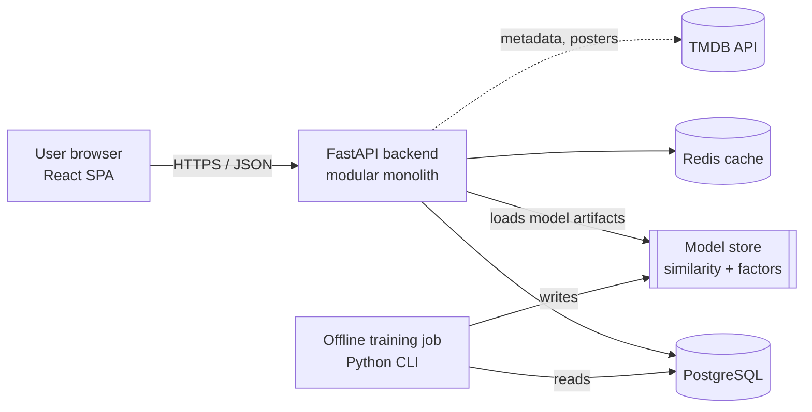

# CineRec — Personalized Movie Recommendation Web Platform

> Diploma project: **Development of a Personalized Movie Recommendation Web Platform**
> Author: _Alina Otuzbayeva_ · Supervisor: _Chingiz Kharmysov_ · University: _Astana IT University / Software Engineering_ · Year: 2026

CineRec is a web platform that helps a user decide **what to watch next**. It learns each user's taste from ratings, a watchlist and "not interested" feedback, and produces a ranked, *explained* list of movies ("Because you rated *Inception* 5★"). The recommendation engine is a **hybrid** of content-based filtering, item-based collaborative filtering and matrix factorization, evaluated offline on MovieLens and with a small user study.

---

## Project status

| Stage | Status |
|---|---|
| Proposal & scope | ✅ Done — [docs/01](docs/01-proposal-and-scope.md) |
| Literature review, system & technology comparison | ✅ Done — [docs/02](docs/02-literature-review.md), [03](docs/03-existing-systems-comparison.md), [04](docs/04-technology-comparison.md) |
| Requirements & acceptance criteria | ✅ Done — [docs/05](docs/05-requirements-and-acceptance-criteria.md) |
| Architecture & diagrams (editable sources) | ✅ Done — [docs/06](docs/06-architecture.md) |
| Prototype (clickable UI + toy recommender) | ✅ Done — [prototype/](prototype/) |
| Verification & evaluation plan | ✅ Done — [docs/07](docs/07-verification-and-evaluation-plan.md) |
| Task tracking | ✅ Backlog ready — [docs/08](docs/08-project-management.md) |
| MVP implementation (backend, frontend, ML) | ⏳ Planned (see roadmap) |

## Repository contents (checklist for the diploma requirements)

| Required item | Where |
|---|---|
| Completed project README | this file |
| Project proposal and scope | [`docs/01-proposal-and-scope.md`](docs/01-proposal-and-scope.md) |
| Literature review | [`docs/02-literature-review.md`](docs/02-literature-review.md) |
| Existing system comparison | [`docs/03-existing-systems-comparison.md`](docs/03-existing-systems-comparison.md) |
| Technology comparison | [`docs/04-technology-comparison.md`](docs/04-technology-comparison.md) |
| Initial requirements & acceptance criteria | [`docs/05-requirements-and-acceptance-criteria.md`](docs/05-requirements-and-acceptance-criteria.md) |
| Architectural diagrams (+ editable sources) | [`docs/06-architecture.md`](docs/06-architecture.md), sources in [`docs/diagrams/src/`](docs/diagrams/src) (Mermaid `.mmd`), renders in [`docs/diagrams/rendered/`](docs/diagrams/rendered) |
| Prototype materials | [`prototype/index.html`](prototype/index.html) (open in a browser) + [`prototype/README.md`](prototype/README.md) |
| Verification & evaluation plan | [`docs/07-verification-and-evaluation-plan.md`](docs/07-verification-and-evaluation-plan.md) |
| YouTrack link with assigned, prioritized tasks | **<https://REPLACE-ME.youtrack.cloud/agiles/…>** ← _paste your board link here_; backlog to import: [`docs/youtrack/backlog.csv`](docs/youtrack/backlog.csv), overview: [`docs/08-project-management.md`](docs/08-project-management.md) |

## Key ideas

1. **Hybrid recommender** — popularity baseline → content-based (TF-IDF on genres/keywords/overview) → item-kNN CF → implicit-feedback matrix factorization (ALS/BPR) → weighted hybrid with cold-start fallbacks.
2. **Explainability** — every recommendation carries a human-readable reason and the user can say *not interested*.
3. **Measurable quality** — Precision/Recall/NDCG@K, coverage, novelty and diversity offline; SUS and ResQue-style questionnaire in a user study.
4. **Privacy by design** — minimal data, hashed passwords, account deletion and data export.

## Planned technology stack (see [docs/04](docs/04-technology-comparison.md) for the reasoning)

| Layer | Choice |
|---|---|
| Frontend | React + TypeScript + Vite |
| Backend API | Python 3 + FastAPI |
| Database | PostgreSQL |
| Cache | Redis |
| ML | pandas, scikit-learn, `implicit` (ALS/BPR); PyTorch for optional stretch goals |
| Data | MovieLens (training/evaluation), TMDB API (metadata, posters) |
| Delivery | Docker Compose, GitHub Actions CI |
| Quality | pytest, Playwright, Locust, Lighthouse/axe |

## Architecture at a glance



More diagrams (use cases, containers, ER, sequence, pipeline, deployment): [docs/06-architecture.md](docs/06-architecture.md).

## Prototype

Open `prototype/index.html` in any browser (no build step). Pick genres, rate a few films, and watch the "Recommended for you" row re-rank with explanations. It runs a small content-based recommender in the browser on 28 illustrative movies. Details: [prototype/README.md](prototype/README.md).

## Roadmap (16 weeks, adjust to your university calendar)

| Weeks | Milestone |
|---|---|
| 1–2 | Proposal, scope, literature review, requirements (✅ this repo) |
| 3 | Architecture, prototype, YouTrack backlog (✅ this repo) |
| 4–5 | Data ingestion (MovieLens + TMDB), DB schema, auth |
| 6–7 | Catalog, search, ratings, watchlist, onboarding |
| 8–9 | Baseline + content-based + item-kNN recommenders, offline evaluation harness |
| 10–11 | Matrix factorization, hybrid, cold-start, explanations |
| 12 | Recommendation UI integration, caching, performance tuning |
| 13 | Testing (unit/API/E2E/load/accessibility), user study |
| 14 | Analysis of results, fixes |
| 15–16 | Thesis text, defence slides, final polish |

## Getting started (planned — will work once the MVP lands)

```bash
git clone <this-repo>
cd cinerec
cp .env.example .env            # add TMDB_API_KEY
docker compose up --build       # api, web, postgres, redis
python -m ml.cli ingest         # load MovieLens + TMDB metadata
python -m ml.cli train          # build model artifacts
open http://localhost:5173
```

## Data, licences and attribution

* **MovieLens** — for research/education only; do not redistribute the raw files in this repo. Cite: Harper & Konstan, *The MovieLens Datasets: History and Context*, ACM TiiS 5(4), 2015.
* **TMDB** — this product uses the TMDB API but is not endorsed or certified by TMDB. Keep the attribution in the UI footer and check their current terms before any public deployment.

## Repository layout

```
cinerec/
├── README.md
├── docs/
│   ├── 01-proposal-and-scope.md
│   ├── 02-literature-review.md
│   ├── 03-existing-systems-comparison.md
│   ├── 04-technology-comparison.md
│   ├── 05-requirements-and-acceptance-criteria.md
│   ├── 06-architecture.md
│   ├── 07-verification-and-evaluation-plan.md
│   ├── 08-project-management.md
│   ├── diagrams/src/        # editable Mermaid sources
│   ├── diagrams/rendered/   # SVG/PNG exports
└── prototype/               # clickable prototype
```
