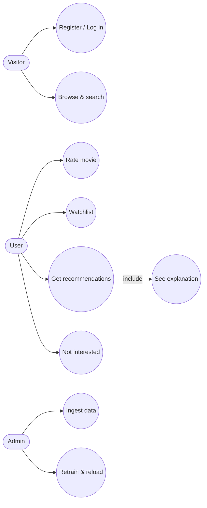

# 6. Architecture

All diagrams are **text-based Mermaid sources** in [`diagrams/src/`](diagrams/src) (edit them with any text editor, VS Code's Mermaid extension, or <https://mermaid.live>). SVG exports are in [`diagrams/rendered/`](diagrams/rendered). GitHub renders the Mermaid blocks below directly.

To re-export after editing:

```bash
npm i -g @mermaid-js/mermaid-cli
for f in docs/diagrams/src/*.mmd; do mmdc -i "$f" -o "docs/diagrams/rendered/$(basename "${f%.mmd}").svg" -b transparent; done
```

| # | Diagram | Source | Render |
|---|---|---|---|
| 1 | Use cases | [01-use-cases.mmd](diagrams/src/01-use-cases.mmd) | [svg](diagrams/rendered/01-use-cases.svg) |
| 2 | Containers / components | [02-containers.mmd](diagrams/src/02-containers.mmd) | [svg](diagrams/rendered/02-containers.svg) |
| 3 | Data model (ER) | [03-er-diagram.mmd](diagrams/src/03-er-diagram.mmd) | [svg](diagrams/rendered/03-er-diagram.svg) |
| 4 | Sequence: get recommendations | [04-sequence-recommendations.mmd](diagrams/src/04-sequence-recommendations.mmd) | [svg](diagrams/rendered/04-sequence-recommendations.svg) |
| 5 | Recommendation pipeline | [05-recommendation-pipeline.mmd](diagrams/src/05-recommendation-pipeline.mmd) | [svg](diagrams/rendered/05-recommendation-pipeline.svg) |
| 6 | Deployment | [06-deployment.mmd](diagrams/src/06-deployment.mmd) | [svg](diagrams/rendered/06-deployment.svg) |

## 6.1 Style and principles

* **Modular monolith** (ADR-001 in [doc 04](04-technology-comparison.md#48-architecture-style-decision-adr-001)): one deployable API with clear modules.
* **Offline/online split**: expensive training is offline; the API only blends precomputed artifacts with light per-user computation.
* **Stateless API**, state in PostgreSQL/Redis; model artifacts are versioned and hot-reloadable.
* **Explainability by construction**: each scorer returns *(score, evidence)*, and the blender keeps the top evidence for the reason text.

## 6.2 Use cases


*Simplified; full version: diagram 1.*

## 6.3 Component responsibilities

| Component | Responsibility | Key interfaces |
|---|---|---|
| React SPA | UI, routing, optimistic updates, accessibility | REST/JSON |
| `auth` | Registration, login, JWT, password hashing, account deletion | `POST /auth/register`, `/auth/login`, `DELETE /me` |
| `catalog` | Movie list, search (pg_trgm), filters, details | `GET /movies`, `/movies/{id}`, `/search` |
| `interactions` | Ratings, watchlist, hidden items, export | `PUT /ratings/{movie_id}`, `POST /watchlist`, `POST /feedback/hidden`, `GET /me/export` |
| `recommendations` | Candidate scoring, hybrid blending, filtering, diversification, reasons | `GET /recommendations`, `GET /movies/{id}/similar` |
| `admin` | Health, model version, reload | `GET /health`, `POST /admin/reload` |
| Offline CLI (`ml`) | ingest, train, evaluate | `python -m ml.cli {ingest,train,evaluate}` |

## 6.4 Planned API sketch

| Method & path | Auth | Description |
|---|---|---|
| `POST /api/v1/auth/register` | – | Create account |
| `POST /api/v1/auth/login` | – | Returns access token |
| `GET /api/v1/movies?q=&genre=&year_from=&year_to=&page=` | optional | Catalogue/search |
| `GET /api/v1/movies/{id}` | optional | Details |
| `GET /api/v1/movies/{id}/similar?n=` | optional | Similar movies |
| `PUT /api/v1/ratings/{movie_id}` body `{value}` / `DELETE` | user | Rate / unrate |
| `POST/DELETE /api/v1/watchlist/{movie_id}` | user | Watchlist |
| `POST /api/v1/feedback/hidden` | user | Not interested |
| `GET /api/v1/recommendations?n=20` | user | Personalized list `[{movie, score, reason}]` |
| `GET /api/v1/me/export`, `DELETE /api/v1/me` | user | Data portability / deletion |
| `GET /api/v1/health`, `POST /api/v1/admin/reload` | admin | Operations |

Full OpenAPI documentation will be generated automatically by FastAPI at `/docs`.

## 6.5 Hybrid scoring (summary)

For user *u* and candidate item *i*, with component scores min-max normalised per request:

```
score(u,i) = w_pop · pop(i) + w_content · cb(u,i) + w_cf · cf(u,i)
cb(u,i)  = cosine(profile_u, tfidf_i),  profile_u = Σ_j (r_uj − mean_u) · tfidf_j
cf(u,i)  = α · itemKNN(u,i) + (1−α) · ALS(u,i)
```

Weights depend on the number of ratings *n_u* (cold < 5, warming 5–19, warm ≥ 20 — initial values from diagram 5, to be tuned on the validation split). The final list is re-ranked with Maximal Marginal Relevance (λ ≈ 0.8) for diversity. The reason text names the liked movie with the highest contribution ("Because you rated *X* 5★") or the shared genres ("Matches your interest in Sci-Fi and Thriller").

## 6.6 Security and privacy design

* Passwords: argon2id (or bcrypt) with per-user salt; rate-limited login; generic error messages.
* Tokens: short-lived JWT access tokens; HTTPS only; CORS restricted to the SPA origin.
* Input validation with Pydantic; parameterised queries via SQLAlchemy (no string-built SQL).
* Secrets in environment variables, never in git (`.env` ignored).
* Data minimisation, deletion cascade, CSV/JSON export (FR-04, FR-05, NFR-05).

## 6.7 Quality-attribute tactics

| Quality | Tactic |
|---|---|
| Performance | Precomputed top-K neighbours, Redis cache with 5-min TTL, DB indexes on `(user_id, movie_id)` |
| Scalability | Stateless API behind a proxy; artifacts in shared volume; module boundaries allow later extraction of `recommendations` |
| Reliability | Cached TMDB metadata; health endpoint; model-version rollback by keeping the last artifact set |
| Reproducibility | Fixed seeds, dataset version recorded in `model_version.metrics`, one-command pipeline |
| Testability | Pure-function scorers; dependency injection for DB/cache |
